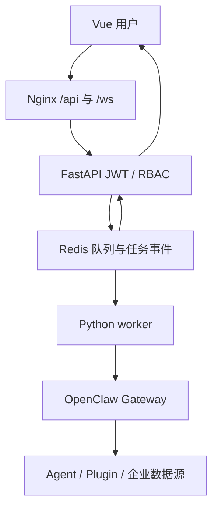

# OpenClaw 企业 AI 平台（Vue + Nginx + FastAPI + Redis）

Python 依赖由 `backend/pyproject.toml` 与 `backend/uv.lock` 管理，Ubuntu 本地开发与 Docker 镜像均使用 uv 锁定安装。

本版本在上一版工程上加入 JWT 登录、RBAC、Redis 任务与事件持久化、真实 Gateway WebSocket 调用、Agent/Tool 事件展示、取消/超时/重试、操作审计及 Docker Compose。OpenClaw Gateway 和 RAGFlow 可以独立部署在云端；平台 Worker 通过配置的 WebSocket 地址访问 Gateway。

> Worker 通过 Gateway 执行 Agent。知识库接入独立部署的 RAGFlow；指标接口仍返回 501，等待接入现有指标服务。

## 业务链路



用户登录后发起任务，FastAPI 创建任务并写入 Redis；worker 启动真实 Agent run，按 `runId` 过滤 Gateway 事件，将助手文本和 Tool 名称、阶段写入 Redis Stream；浏览器通过短期一次性 WebSocket ticket 订阅该任务，刷新后可从 `/api/tasks/{id}/events` 补读。取消会向 Gateway 发送 `chat.abort`；重试会创建新的任务和独立 session，避免悄悄重复同一次执行。

| 角色 | 权限 |
| --- | --- |
| viewer | 查看自己的任务、查看可选 Agent |
| operator | viewer 权限，加上创建/取消/重试任务及知识库检索 |
| admin | operator 权限，加上创建用户、查看所有任务与审计日志 |

后端每个接口校验角色与任务所有权；隐藏前端菜单并不构成授权。Gateway 凭据仅在 worker 环境变量中，浏览器只收到企业平台的 JWT。审计记录包括登录、创建用户、任务创建、取消和重试，不记录密码、Gateway token 和工具参数。Redis AOF 保存任务与事件；单 worker 串行消费，扩展为多 worker 前需要增加分布式锁及可靠队列。

## 一、用 Docker Compose 运行（Ubuntu / WSL2）

### 安装 Docker（仅你的 Ubuntu / WSL2 主机）

本项目使用 Compose bridge 网络。Worker 从 `.env` 读取 `OPENCLAW_GATEWAY_URL`，云端 Gateway 需提供 Worker 可达的 `ws://` 或 `wss://` WebSocket 端点；`http://` 管理页面地址不能直接用于 Gateway 连接。

Ubuntu 24.04/22.04 在 **同一 WSL Ubuntu 实例** 内，按 [Docker 官方 Ubuntu 安装说明](https://docs.docker.com/engine/install/ubuntu/) 配置仓库并安装（已经安装 Docker 的主机直接运行下面的版本检查即可）：

```bash
sudo apt update
sudo apt install -y ca-certificates curl
sudo install -m 0755 -d /etc/apt/keyrings
sudo curl -fsSL https://download.docker.com/linux/ubuntu/gpg -o /etc/apt/keyrings/docker.asc
sudo chmod a+r /etc/apt/keyrings/docker.asc
sudo tee /etc/apt/sources.list.d/docker.sources >/dev/null <<EOF
Types: deb
URIs: https://download.docker.com/linux/ubuntu
Suites: $(. /etc/os-release && echo "${UBUNTU_CODENAME:-$VERSION_CODENAME}")
Components: stable
Architectures: $(dpkg --print-architecture)
Signed-By: /etc/apt/keyrings/docker.asc
EOF
sudo apt update
sudo apt install -y docker-ce docker-ce-cli containerd.io docker-buildx-plugin docker-compose-plugin
sudo systemctl enable --now docker
docker --version
docker compose version
sudo docker run hello-world
```

WSL 内需要启用 systemd 才能使用上述 `systemctl` 命令。安装只在你的宿主机执行，本交付包不会修改系统级 Docker 配置。若 apt 报告已有 `docker.io`、旧 Compose 或 `containerd` 冲突，先阅读官方文档的“Uninstall old versions”，核实本机服务和数据再处理。

### 启动与验收

1. 确认 OpenClaw Gateway 在同一台 Ubuntu / WSL2 宿主机运行，并且 agent 配置及模型正常：

   ```bash
   openclaw gateway status
   openclaw agents list
   ```

2. 解压工程，配置密钥：

   ```bash
   unzip openclaw-enterprise-platform.zip
   cd openclaw-enterprise-platform
   cp .env.example .env
   python3 -c 'import secrets; print(secrets.token_urlsafe(48))'
   ```

   把随机值分别填入 `.env` 的 `JWT_SECRET` 和 `PLUGIN_SERVICE_TOKEN`。从 Gateway 宿主机的交互终端运行 `openclaw gateway auth-token --show`，把输出填入 `OPENCLAW_GATEWAY_TOKEN`；不要把 `.env` 提交到 Git。`ALLOWED_AGENTS` 与 `openclaw agents list` 的 ID 对齐。

3. 启动容器并创建第一个管理员：

   ```bash
   sudo docker compose config --quiet
   sudo docker compose up -d --build
   sudo docker compose ps
   sudo docker compose exec -e BOOTSTRAP_ADMIN_USER=admin -e BOOTSTRAP_ADMIN_PASSWORD='换成至少12位的强密码' api python -m app.bootstrap
   ```

   访问 `http://127.0.0.1/`，用刚创建的管理员登录。Nginx 对外监听 80，FastAPI 仅通过宿主机 `127.0.0.1:8100` 提供插件接口，Redis 仅在 Compose 内部网络开放。确认 Worker 可以访问配置的云端 Gateway WebSocket。

4. 首次 Gateway 设备配对：先在页面创建一条测试任务，然后查看：

   ```bash
   sudo docker compose logs worker --tail=80
   openclaw devices list
   ```

   如果出现 `PAIRING_REQUIRED`，用 `openclaw devices approve <requestId>` 批准对应请求，再在页面点“重试”。worker 的设备私钥放在 `device_identity` Docker volume，重建容器时不要删除该卷。Gateway 协议与客户端需一起核对版本；这里按当前协议版本 4 实现，升级 OpenClaw 后应先做联调。

5. 在 Gateway 所在宿主机执行 `bash scripts/install_plugin.sh` 安装 `knowledge_search` 插件。插件进程需要能读取与 API 相同的 `PLUGIN_SERVICE_TOKEN` 环境变量。云端 Gateway 应设置 `KNOWLEDGE_URL` 为从 Gateway 主机可达的 `https://<platform-host>/knowledge/search` 后再执行脚本；本地默认地址 `127.0.0.1:8100` 只适用于 Gateway 与 API 同机。指标接口仍返回 501。

6. 执行自动验收：`sudo bash scripts/verify_docker.sh`。它会先执行 `docker compose config --quiet`，再检查 Vue 首页、FastAPI/Redis 健康状态、JWT 登录，创建一条真实 OpenClaw Agent 任务，等待完成并读取事件。脚本会交互式要求账号密码，失败时返回非零退出码；若 Gateway 要求设备配对，先完成第 4 步再重试。

7. 创建业务账号：在浏览器登录后，向 `POST /api/users` 发送 `Authorization: Bearer <JWT>`，请求体如 `{"username":"analyst","password":"至少12位的强密码","role":"operator"}`。管理员也可以从 FastAPI `/docs` 中测试；凭据不要保存到共享终端历史。日志：`sudo docker compose logs -f api worker web`。停止：`sudo docker compose down`（不加 `-v`，保留 Redis 和设备身份卷）。

## 二、Windows 启动应用，连接 WSL Ubuntu Docker

**开发阶段：**Vue、FastAPI、Worker 可在 Windows PowerShell 运行；Redis 和 Gateway 需要单独启动并确认 Windows 可达。**部署阶段：**在 WSL Ubuntu 使用根目录 `compose.yaml` 启动平台。

Windows 需要安装 Python 3.12、uv、Node 22+ 和 npm；Ubuntu 部署需要 Docker Compose 与已启动的 Gateway。在 Windows PowerShell 检查 Redis 与 Gateway 是否可达：

```powershell
Test-NetConnection 127.0.0.1 -Port 6379
Test-NetConnection 127.0.0.1 -Port 18789
```

两项都应显示 `TcpTestSucceeded : True`。如果服务不在 localhost，按实际地址设置 `REDIS_URL` 和 `OPENCLAW_GATEWAY_URL`。不要为了调通连接把 Redis 或 Gateway 直接暴露到公网。

在 Windows PowerShell 进入工程，复制 `.env.example` 为 `.env`，填写 `JWT_SECRET`、`OPENCLAW_GATEWAY_TOKEN`、`PLUGIN_SERVICE_TOKEN` 等真实配置。默认 `REDIS_URL=redis://127.0.0.1:6379/0` 和 `OPENCLAW_GATEWAY_URL=ws://127.0.0.1:18789`，如使用其他转发端口可在 `.env` 中覆盖。依赖安装和管理员初始化在 Windows 执行：

```powershell
Set-Location D:\agent_framework\openclaw-enterprise-platform
Copy-Item .env.example .env
Set-Location backend
uv sync --frozen --no-dev
$env:BOOTSTRAP_ADMIN_USER = 'admin'
$env:BOOTSTRAP_ADMIN_PASSWORD = '换成至少12位的强密码'
uv run --frozen --no-dev --env-file ../.env python -m app.bootstrap
Set-Location ../frontend
npm.cmd ci
Set-Location ..
```

在 Windows 打开三个独立 PowerShell 终端，从项目根目录分别运行；如果系统禁止执行 `.ps1`，在**当前终端**先运行 `Set-ExecutionPolicy -Scope Process Bypass`：

```powershell
.\scripts\start_backend_windows.ps1
.\scripts\start_worker_windows.ps1
.\scripts\start_frontend_windows.ps1
```

访问 `http://127.0.0.1:5173`，验证登录、创建任务、WebSocket 事件及取消/重试。Windows Worker 的设备身份保存在 `backend/.data/`；切到 Docker Worker 时会产生另一份设备身份，可能需要再次批准配对。

本地验证完成后，停止三个 Windows 开发终端，确保 Windows 的 8100、5173 端口已释放。在 WSL Ubuntu 项目目录执行部署：

```bash
docker compose up -d --build
docker compose ps
```

按第一节初始化容器中的管理员、批准容器 Worker 的设备配对，并运行 `bash scripts/verify_docker.sh`。不要运行 `docker compose down -v`，否则 Redis 数据卷会被删除。

## API 与状态

- `POST /api/auth/login`：JWT 登录；`GET /api/auth/me`：当前账号
- `POST /api/users`：管理员创建用户
- `GET /api/agents`、`GET /api/dashboard`：可选 Agent 与统计
- `POST /api/chat`、`POST /api/tasks`：入队，返回任务 ID
- `GET /api/tasks`、`GET /api/tasks/{id}`、`GET /api/tasks/{id}/events`：查询与补读事件
- `POST /api/tasks/{id}/ws-ticket`、`WS /ws/tasks/{id}?ticket=...`：一次性 30 秒票据，实时状态
- `POST /api/tasks/{id}/cancel`、`POST /api/tasks/{id}/retry`：取消、重试
- `GET /api/audit`：管理员审计记录
- `GET/POST /api/knowledge/bases`、`GET/DELETE /api/knowledge/bases/{id}`：知识库管理
- `GET/POST /api/knowledge/bases/{id}/documents`、文档状态、解析和删除接口：文档管理
- `POST /api/knowledge/retrieval`：按 RBAC 检索并返回 Chunk、分数与来源
- `POST /knowledge/search`：仅插件可用的检索接口，要求 `X-Plugin-Token`；`POST /metrics/query` 仍待接入指标服务

任务状态为 `queued → running → completed/failed/cancelled/timed_out`。进度不显示虚构百分比。普通 Tool 事件只保存名称、阶段和调用 ID；`knowledge_search` 额外保存有限长度的 query、结果数及真实文档来源，不转发完整工具输出。任务结果来自 Gateway 的 assistant 事件；若该版本 Gateway 不提供文本，需对照 `chat.history` 适配结果提取。

## 部署边界和注意事项

- 当前 Nginx 容器默认 **HTTP :80**。公网部署前应配置 HTTPS 证书、443、HTTP→HTTPS 跳转和防火墙；不要把当前 HTTP 配置直接当作已启用 TLS 的生产配置
- 用户 JWT 仅保存在浏览器内存，刷新页面需重新登录；建议在正式 SSO/长期会话接入时换成 HttpOnly Cookie + CSRF 防护
- WebSocket ticket 会出现在 URL 中，有 30 秒 TTL 且只能使用一次；公网反代的访问日志应去掉查询字符串
- worker 崩溃后，已在运行的任务会标记失败；重试前先确认 Gateway 原 run 状态，以免产生重复业务操作
- Redis Stream 仅保留最近 2000 条任务事件和 10000 条审计事件。长期留存/合规审计应写入独立数据库和备份系统
- 项目没有真实的 OpenClaw Gateway 和原业务插件可在此环境直接连通，部署后按上面的测试任务及设备配对步骤完成端到端验收

测试后端（可不启动 Docker）：`cd backend && uv sync --frozen && PYTHONPATH=. JWT_SECRET=testing-secret-of-at-least-32-bytes uv run --frozen pytest -q tests`。

参考：[Gateway 外部应用接入](https://docs.openclaw.ai/gateway/external-apps)、[Gateway 协议](https://docs.openclaw.ai/gateway/protocol)、[客户端认证与 Tool Events](https://docs.openclaw.ai/gateway/clients)。

## RAGFlow 知识库

企业知识问答、文档草稿两个 OpenClaw Skill 已随企业插件提供。部署检查、调用示例与验收步骤见 [Skill 试点说明](plugin/SKILLS_README.md)；首期保持现有前端、任务 API 和 Worker 调用链。

RAGFlow 作为本地或云端的独立服务运行。在其管理界面创建 API Key，并将以下值只写入本项目后端的 `.env`：

```text
RAGFLOW_BASE_URL=https://<your-ragflow-host>
RAGFLOW_API_KEY=<ragflow-api-key>
RAGFLOW_TIMEOUT_SECONDS=30
```

`RAGFLOW_BASE_URL` 必须从 API 容器或后端进程可达。`RAGFLOW_API_KEY` 不进入 Vue、Nginx 或插件配置。浏览器通过 Nginx 的 `/api/knowledge/` 路由访问 FastAPI，Nginx 现有 `/api/` 转发规则已覆盖这些路径。

如果 RAGFlow 运行在 Windows 宿主机，而本平台运行在 Docker Desktop 容器中，`.env` 使用 `RAGFLOW_BASE_URL=http://host.docker.internal:8080`（端口按 RAGFlow 实际映射调整）；容器中的 `localhost` 指向容器自身。修改 `.env` 后执行 `docker compose up -d --force-recreate api worker` 使新配置生效。

管理员登录后进入“知识库”，创建知识库或关联已有 RAGFlow 数据集，上传文档，点击“解析”，再刷新查看状态。状态由 RAGFlow 的 `run` 字段映射为 pending、parsing、completed、failed。检索测试可选择知识库、输入问题、调整返回条数和相似度阈值；结果直接显示 Chunk、分数和来源，不调用 LLM。管理员可删除文档和知识库，删除知识库会删除其 RAGFlow 数据。

Agent 调用 `knowledge_search` 时，插件只向 FastAPI 内部 `POST /knowledge/search` 发检索请求，后端再调用 RAGFlow。插件从 Gateway 进程环境读取 `PLUGIN_SERVICE_TOKEN`，与 API 的值必须相同。为 Agent 配置工具策略时只允许 `knowledge_search`，不要授予管理类 API。Worker 保留 Gateway 的 Tool 事件；如果 Gateway 的 Tool 结果事件包含检索结果，任务快照会携带真实文档来源供聊天页展示。没有结果时来源列表为空。

常见排查：503 表示后端未配置 RAGFlow；502/504 表示 RAGFlow 返回错误、不可达或超时；空知识库检索返回空结果，需先上传并解析文档；RAGFlow Cloud 若提示 API Key 需要 Starter/Pro 套餐，需在云端解决账号权限后再验收；平台返回 403 表示 RBAC 不允许当前操作。插件报未配置时检查 Gateway 进程的 `PLUGIN_SERVICE_TOKEN` 和 `knowledgeUrl`。云端插件要能通过 HTTPS 访问平台 `/knowledge/search`；本项目 Nginx 提供该路由，但当前 Compose 只监听 HTTP，跨互联网部署需配置 TLS 入口。不要在日志中打印 API Key。

本地验证命令：`cd backend && uv run python -m pytest -q && uv run python -m compileall app`，`cd frontend && npm run build`，以及在配置好 `.env` 后运行 `docker compose config --quiet`。真实 RAGFlow 与 Gateway 的端到端验收需要使用目标部署环境执行。

完整知识库任务验收：在项目根目录运行 `uv run --project backend python scripts/verify_knowledge.py --query "你的知识库问题"`。脚本要求账号具有创建任务的权限；默认交互输入账号密码，也可以从已忽略提交的 `.env` 读取 `VERIFY_USERNAME` 和 `VERIFY_PASSWORD`，验证后移除这两项。它通过 Nginx 登录并提交聊天任务，验证真实 Worker 的 Tool 开始/结果事件、WebSocket 终态回答、文档来源和事件回放；不会打印密码、JWT、WebSocket ticket 或文档正文。
