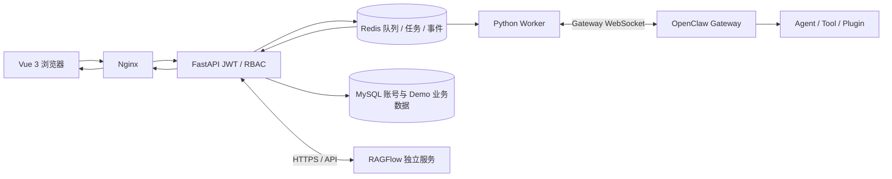

# OpenClaw 企业智能体平台

面向企业业务人员与平台管理员的智能体工作平台。用户可通过 AI 助手提交 Agent 任务、查看执行轨迹，并在知识库、订单、客户与数据分析页面查询企业数据；管理员可维护账号权限、Agent 可用性、任务策略并排查运行状态。

> 详细的页面操作步骤、角色使用方法与常见问题见[用户使用说明书](user-manual.md)。本 README 面向项目部署者、开发者与运维人员。

## 目录

- [功能概览](#功能概览)
- [角色与菜单权限](#角色与菜单权限)
- [系统架构](#系统架构)
- [数据与安全边界](#数据与安全边界)
- [技术栈与目录](#技术栈与目录)
- [部署要求](#部署要求)
- [Docker Compose 部署](#docker-compose-部署)
- [Windows 本地开发](#windows-本地开发)
- [接口与任务状态](#接口与任务状态)
- [运维与验收](#运维与验收)
- [开发测试](#开发测试)
- [相关文档](#相关文档)

## 功能概览

| 菜单 | 当前能力 | 可用角色 |
| --- | --- | --- |
| 总览 | 当前可见任务统计、任务趋势、失败任务、运行观测与 Gateway 状态 | 全部角色 |
| AI 助手 | 选择启用的 Agent 对话，查看助手回复、Tool 过程、知识引用和实时执行轨迹 | operator、admin |
| Agent 管理 | 查看 Agent、模型、Tool 策略及近 30 天任务统计；管理员可创建 Agent、切换平台可用状态 | 查看：全部；管理：admin |
| 知识库 | 浏览文档和解析状态、执行检索测试；管理员可创建或关联 RAGFlow 知识库、上传解析及删除文档 | operator、admin |
| 订单管理 | 按订单号、客户名或商品名筛选订单并查看商品明细 | operator、admin |
| 客户管理 | 搜索客户、筛选等级和状态、查看脱敏联系方式及订单摘要 | operator、admin |
| 数据分析 | 查询销售额、订单数、退款率和活跃客户数；提交受控的只读数据库问答任务 | operator、admin |
| 任务中心 | 查询任务、查看事件；有任务写权限的用户可创建、取消、重试 | 查看：全部；操作：operator、admin |
| 人工审批 | 查看 Agent 提交的任务取消申请；管理员审批他人申请 | operator、admin |
| 运行监控 | 搜索任务、查看 Trace 和事件时间线及安全摘要 | admin |
| 审计日志 | 搜索最近的登录、账号、任务、Agent、知识库、审批和策略操作记录 | admin |
| 系统设置 | 管理账号角色和状态、重置密码、配置任务策略、检测依赖 | admin |

**业务数据菜单当前为只读。**订单、客户和固定指标使用独立 Demo MySQL 数据；页面不提供订单写入、退款、发货或客户档案修改。系统设置的任务策略可以暂停新提交并调整默认超时，暂停不终止已运行任务。Agent 创建会在 OpenClaw Gateway 建立 Agent/Workspace；平台停用只阻止平台新任务选择，不会删除 Gateway Agent。

## 角色与菜单权限

| 角色 | 主要权限 |
| --- | --- |
| `viewer`（查看者） | 查看总览、Agent 列表和本人有权查看的任务；不能提交或变更任务。 |
| `operator`（业务操作员） | 查看者能力，加上创建/取消/重试任务、知识检索、只读业务查询；只能查看本人任务及本人发起的审批申请。 |
| `admin`（管理员） | 平台管理权限：查看平台任务与审计、管理账号、Agent 和知识库、修改任务策略、处理非本人发起的审批。 |

权限在 FastAPI 后端按角色和资源所有权校验，前端菜单隐藏只用于界面导航，不作为授权边界。管理员账号保存在 MySQL `platform_users`，角色、停用或密码变更会使旧会话失效。创建账号和密码至少 12 位；系统保护最后一个可用管理员。

## 系统架构



主要调用链：`Vue -> Nginx -> FastAPI -> Redis -> Worker -> OpenClaw Gateway -> Agent/Tool -> Redis 事件 -> WebSocket -> Vue`。任务提交由 API 持久化并入 Redis 队列，Worker 调用真实 Gateway run 并保存阶段事件；浏览器使用一次性短期 WebSocket ticket 订阅，断线或刷新后通过任务事件接口补读。取消向 Gateway 请求 `chat.abort`；重试创建新的任务和独立 session。

## 数据与安全边界

| 数据 | 存储或来源 | 说明 |
| --- | --- | --- |
| 平台用户与密码摘要 | MySQL `platform_users` | MySQL 是账号主存储；旧 Redis 账号只做一次性无覆盖迁移。 |
| 登录刷新会话、任务、队列、事件、审计、任务策略和运行心跳 | Redis | Compose 使用持久化 volume；任务事件流和审计流均有保留上限，不替代长期合规归档。 |
| 订单、客户、商品与指标 | 独立 Demo MySQL schema | 平台业务账号对业务表只读；当前数据仅用于 Demo/开发验证，不是生产经营账本。 |
| 企业文档与检索索引 | 外部 RAGFlow | RAGFlow 独立部署；知识库删除会删除对应的 RAGFlow 数据。 |
| Gateway 凭据与模型配置 | 部署环境变量 / Gateway | Gateway 凭据留在服务端，不下发给浏览器；Agent 与模型由 Gateway 提供。 |

业务 MySQL 初始化脚本位于 `database/migrations/`。首次创建数据卷时 MySQL 会执行初始化；已有 volume 不会自动重放新增迁移，需按版本说明手动执行相应迁移。Redis 保存任务当前运行数据，单个任务事件流最多保留约 2,000 条记录，审计流最多约 10,000 条。生产环境需要独立规划备份、保留周期和审计归档。

开放式数据库问答由专用 Worker 流程生成候选查询，服务端以 SQL AST、表列/函数白名单、参数绑定、只读账号和行数限制执行单条只读查询。它不会把普通聊天 Agent 暴露成拥有任意 SQL 执行权限的工具。审批中的高风险动作当前为平台任务取消申请；订单/客户数据仍不可由该流程写入。

## 技术栈与目录

- 前端：Vue 3、TypeScript、Element Plus、Pinia、Vite
- API / Worker：Python、FastAPI、Redis 异步客户端
- 持久化：Redis（任务与运行态）、MySQL 8.4（用户和 Demo 业务数据）
- Agent Runtime：OpenClaw Gateway WebSocket
- 知识库：独立 RAGFlow 服务
- 部署：Docker Compose、Nginx、Docker volumes

| 路径 | 职责 |
| --- | --- |
| `frontend/` | Vue 页面、登录、菜单、任务提交与实时事件展示 |
| `backend/app/` | FastAPI、权限检查、Worker、Gateway 客户端、数据服务与任务处理 |
| `backend/tests/` | 后端测试 |
| `database/migrations/` | MySQL schema、Demo 数据及迁移脚本 |
| `plugin/` | OpenClaw 企业数据 Plugin / Tool 与 Skills |
| `nginx/` | 静态资源托管、API/WebSocket 反向代理 |
| `scripts/` | 初始化、Windows 启动、插件安装和验收脚本 |
| `evaluation/` | 离线 Agent 评测数据与报告 |
| `design/` | UI 参考、产品设计与实施进度资料（如当前分支包含） |

Python 依赖由 `backend/pyproject.toml` 与 `backend/uv.lock` 管理；本地及 Docker 使用 uv 锁定依赖。

## 部署要求

- Docker Engine 与 Docker Compose Plugin（Compose 部署）
- 可由 Worker 访问的 OpenClaw Gateway WebSocket 地址，协议应与项目客户端兼容；`http://` 管理页面地址不能代替 Gateway WebSocket 地址
- 配置正确的 Gateway Agent、模型和 Tool 策略
- 若使用知识库，部署 API 可达的 RAGFlow 服务并准备 API Key
- Linux / WSL 部署命令按需使用 `sudo`；下文示例按有 Docker 权限书写

Gateway 必须保持在 WSL Ubuntu/宿主机可运行的独立环境中。RAGFlow 也作为独立服务部署，不由本项目 Compose 创建。

## Docker Compose 部署

以下命令在项目根目录执行。首次部署前先配置环境并检查 Compose 展开结果。

### 1. 准备环境文件

```bash
cp .env.example .env
python3 scripts/init_business_env.py
```

编辑 `.env`，配置 `JWT_SECRET`、`PLUGIN_SERVICE_TOKEN`、`OPENCLAW_GATEWAY_URL` 和 `OPENCLAW_GATEWAY_TOKEN`。`JWT_SECRET` 与插件服务令牌应使用独立的强随机值；不要提交 `.env` 或 `.env.business`。`scripts/init_business_env.py` 仅在文件不存在时生成本地 Demo MySQL 凭据，不覆盖现有值。

常用配置：

| 变量 | 用途 |
| --- | --- |
| `JWT_SECRET` | JWT 签名密钥，至少 32 字符 |
| `ACCESS_TOKEN_EXPIRE_MINUTES`、`REFRESH_TOKEN_EXPIRE_DAYS` | 登录会话时长 |
| `REFRESH_COOKIE_SECURE`、`AUTH_ORIGIN` | Refresh Cookie 与来源策略；公网部署应配合 HTTPS 设置 |
| `OPENCLAW_GATEWAY_URL`、`OPENCLAW_GATEWAY_TOKEN` | Worker 连接 Gateway 的 WebSocket 地址与凭据 |
| `ALLOWED_AGENTS` | 初始化平台可用 Agent ID 列表，需与 Gateway 配置对齐 |
| `PLUGIN_SERVICE_TOKEN` | 后端 Plugin 内部接口认证；Gateway Plugin 进程需配置相同值 |
| `RAGFLOW_BASE_URL`、`RAGFLOW_API_KEY` | 可选的 RAGFlow 连接配置，仅由后端使用 |
| `RAGFLOW_TIMEOUT_SECONDS`、`RAGFLOW_DATASET_IDS` | RAGFlow 请求超时与可选数据集配置 |

Compose 中 API/Worker 访问 Redis 必须使用 `redis://redis:6379/0`。不要将容器内 Redis 地址改成 `127.0.0.1`。

### 2. 检查配置并启动

```bash
docker compose config --quiet
docker compose ps
docker compose up -d --build
docker compose ps
```

Compose 服务包括 `web`（Nginx）、`api`、`worker`、`redis` 与 `mysql`。当前端口映射为：Nginx `80:80`，API 仅绑定宿主机 `127.0.0.1:8100`，Redis `6380:6379`。Redis 端口虽供宿主机本地工具连接，但不应通过公网暴露；按实际部署网络限制访问。

### 3. 创建首个管理员并登录

```bash
docker compose exec -e BOOTSTRAP_ADMIN_USER=admin -e BOOTSTRAP_ADMIN_PASSWORD='替换为至少12位的强密码' api python -m app.bootstrap
```

该命令创建 MySQL 管理员账号。浏览器打开 `http://127.0.0.1/`，使用该账号登录。首次部署由 MySQL volume 自动执行迁移。**使用已有 MySQL volume 升级**时，初始化目录不会自动重跑；若该库尚无平台用户表，先在维护窗口执行：

```bash
docker compose exec -T mysql sh /docker-entrypoint-initdb.d/006_platform_users.sh
```

迁移前需核对目标环境及备份状态。其他 schema 更新请依照 `database/migrations/` 中迁移说明逐项执行。

### 4. 完成 Gateway 配对与 Plugin 配置

提交一条测试任务后检查 Worker 日志：

```bash
docker compose logs worker --tail=80
openclaw devices list
```

若出现 `PAIRING_REQUIRED`，在 Gateway 所在主机批准对应请求：

```bash
openclaw devices approve <requestId>
```

再从页面重试任务。Worker 设备身份保存在 Docker volume；不要为普通容器重建删除持久化卷。将 `plugin/` 中企业 Plugin 安装到 Gateway 环境（见 `scripts/install_plugin.sh`），并确保 Gateway 进程可读取相同 `PLUGIN_SERVICE_TOKEN`。云端 Gateway 还需把 `KNOWLEDGE_URL`、`BUSINESS_URL`、`METRICS_URL` 配置为其网络可达的平台地址。

### 5. 验收与常用运维命令

```bash
docker compose ps
docker compose exec redis redis-cli ping
curl -i http://127.0.0.1/health
bash scripts/verify_docker.sh
docker compose logs -f api worker web
docker compose down
```

`verify_docker.sh` 会验证 Compose 配置并调用项目验收脚本；真实 Gateway 验收要求目标 Gateway 在线、模型可用且设备已配对。`docker compose down` 保留 Redis/MySQL/Worker 身份卷；不要为了普通停止使用 `docker compose down -v`。

### 6. Windows / WSL 边界

Windows 可运行前端、FastAPI 和 Worker 进行本地开发；Redis 与 Gateway 必须从 Windows 进程可达。Compose 部署运行于 WSL Ubuntu 时，应在该 Linux 环境执行 Docker Compose 命令，并将 Gateway 地址配置成容器可访问的 WSL/宿主地址。不要假设 Windows 的 `127.0.0.1` 在 Docker 容器内仍指向 Windows 服务。

## Windows 本地开发

需要 Python 3.12、uv、Node.js 22+、npm，以及可访问的 Redis 和 OpenClaw Gateway。将 `.env.example` 复制为 `.env`，配置密钥、Redis 和 Gateway 地址；本地默认 Redis 为 `redis://127.0.0.1:6379/0`，Gateway 默认地址按 `.env.example` 设置。

```powershell
Copy-Item .env.example .env
Set-Location backend
uv sync --frozen --no-dev
$env:BOOTSTRAP_ADMIN_USER = 'admin'
$env:BOOTSTRAP_ADMIN_PASSWORD = '替换为至少12位的强密码'
uv run --frozen --no-dev --env-file ../.env python -m app.bootstrap
Set-Location ../frontend
npm.cmd ci
Set-Location ..
```

从项目根目录在三个 PowerShell 终端分别运行：

```powershell
.\scripts\start_backend_windows.ps1
.\scripts\start_worker_windows.ps1
.\scripts\start_frontend_windows.ps1
```

访问 `http://127.0.0.1:5173`。Windows Worker 设备身份存放在 `backend/.data/`；切换到 Compose Worker 后 Gateway 可能需要对新身份再次配对。管理员初始化仅适用于已配置并可访问的 MySQL 数据库。

## 接口与任务状态

浏览器接口由 Nginx 的 `/api/` 代理至 FastAPI，实时任务使用 `/ws/` WebSocket。FastAPI `/docs` 提供当前安装版本的 OpenAPI 路由与字段定义。

| 路由示例 | 用途 |
| --- | --- |
| `POST /api/auth/login`、`GET /api/auth/me` | 登录与当前账号 |
| `/api/users`、`/api/settings/*` | 管理账号、任务策略与依赖状态（管理员） |
| `/api/agents`、`/api/agents/manage` | Agent 列表、管理与创建 |
| `POST /api/chat`、`POST /api/tasks` | 创建 Agent 对话或任务 |
| `GET /api/tasks`、`GET /api/tasks/{id}`、`GET /api/tasks/{id}/events` | 查询任务及历史事件 |
| `POST /api/tasks/{id}/ws-ticket`、`WS /ws/tasks/{id}?ticket=…` | 获取一次性短期票据并订阅实时事件 |
| `POST /api/tasks/{id}/cancel`、`POST /api/tasks/{id}/retry` | 取消或创建重试任务 |
| `/api/knowledge/*`、`/api/orders/*`、`/api/customers/*`、`/api/metrics/*` | 知识库、业务只读查询和指标 |
| `/api/approvals/*`、`/api/audit`、`/api/monitor/*` | 审批、审计与管理员运行监控 |

任务状态为 `queued -> running -> completed / failed / cancelled / timed_out`。系统展示真实状态和事件，不生成虚构百分比。WebSocket 中断可通过历史事件接口恢复展示。普通 Tool 事件只保留安全摘要；不应把原始工具参数、Token 或凭证写入日志。

Plugin 内部路由如 `/knowledge/search` 与 `/metrics/query` 使用 `X-Plugin-Token`，不面向浏览器用户；调用时应由 Gateway Plugin 服务端发起。具体 API schema 以代码和 `/docs` 为准。

## 运维与验收

- 健康检查：`GET /health` 检查 API 服务；它本身不代表 Worker 或 Gateway 可用。
- Gateway 状态：依赖 Worker 最近的真实 Gateway 握手；无有效检测记录时显示未知。
- 日志：使用 `docker compose logs api worker web`，避免输出环境文件、认证头、密码或 Token。
- 旧数据卷迁移：MySQL 初始化 SQL 只在新 volume 上自动执行；升级前核对对应迁移脚本及数据备份。
- 数据留存：Redis 任务事件与审计采用有限长度保留；如需长期审计，请规划外部归档与备份。
- 并发扩展：当前 Worker 消费与任务执行按项目现有机制工作；扩展多个 Worker 前应验证并发、幂等、Gateway 限额和重复执行语义。

公网部署前需在入口配置 HTTPS、证书、Cookie Secure、来源策略、防火墙和 WebSocket 代理，并限制 Redis 与 API 管理端口访问。当前 Compose Nginx 默认 HTTP `:80`，不能视为已启用 TLS 的生产配置。

## 开发测试

后端测试：

```bash
cd backend
uv sync --frozen
PYTHONPATH=. JWT_SECRET=testing-secret-of-at-least-32-bytes uv run --frozen pytest -q tests
```

前端生产构建：

```bash
cd frontend
npm ci
npm run build
```

Compose 配置检查：

```bash
python3 scripts/init_business_env.py
docker compose config --quiet
```

指标 Demo 数据核验可在 API 容器中执行 `docker compose exec api uv run python -m app.verify_metrics`；数据库只读查询核验为 `docker compose exec api uv run python -m app.verify_database`。`app.verify_database_agent` 会创建一条真实 Gateway 探测任务，应仅在专用验收环境运行。

Agent 离线评测数据 `evaluation/demo_cases.json` 是 Demo/开发测试集，覆盖 Knowledge、Order、Customer、Metrics、Database、Action、HITL 场景，并包含预期失败案例。运行：

```bash
cd backend
uv run python -m app.evaluation --dataset ../evaluation/demo_cases.json --report ../evaluation/phase9-report.json
```

离线评测分数仅表示该模拟数据集的结果，不代表真实 Agent 或生产质量。真实调用评估应使用已记录运行数据；缺少真实价格时成本字段保持未知。

## 相关文档

- [用户使用说明书](user-manual.md)：所有菜单的业务操作步骤、角色适用范围与常见问题。
- [企业 Skill 试点说明](plugin/SKILLS_README.md)：知识问答与文档草稿 Skill 的行为和限制。
- `database/migrations/`：MySQL 初始结构及版本迁移脚本。
- [OpenClaw Gateway 外部应用接入](https://docs.openclaw.ai/gateway/external-apps)、[Gateway 协议](https://docs.openclaw.ai/gateway/protocol)、[Gateway 客户端](https://docs.openclaw.ai/gateway/clients)。
