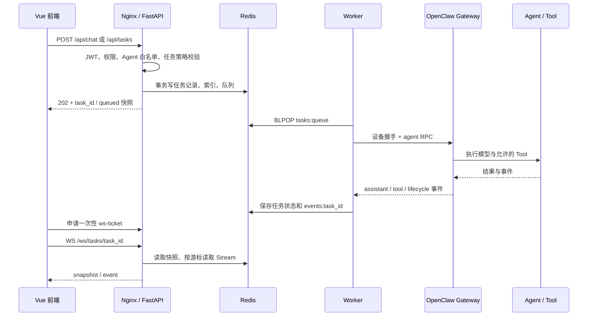
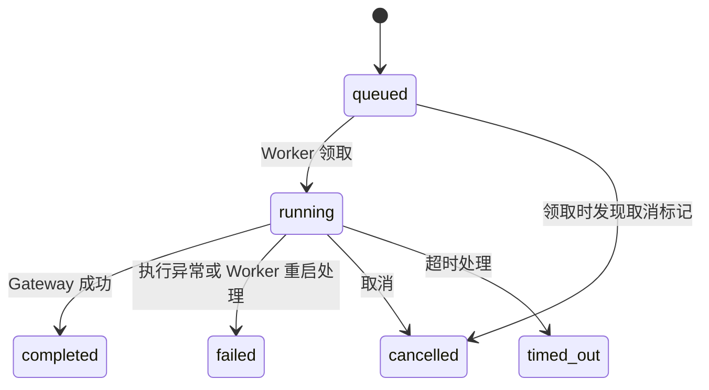
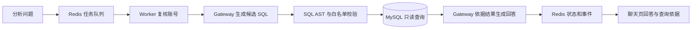

# OpenClaw Enterprise Platform 功能清单与调用链路

> 编制日期：2026-10-05。依据当前工作区实际源码整理，包含尚未提交的模块；本文件描述代码已提供的能力，不把设计计划或历史验收结论当作当前运行验证结果。
>
> 清单规模：115 项编号功能，覆盖当前源码中 65 条 HTTP / WebSocket 路由声明（包含别名）。主体写入后，已按模块分别复核并逐次保存修订。
>
> 阅读方式：先看模块总览，再按功能编号查找入口、处理过程、数据去向和返回方式。文中的接口均为 FastAPI 实际路由；浏览器请求经过 Nginx，开发模式下经过 Vite 代理。

## 1. 模块总览

| 模块 | 页面 / 入口 | 主要功能 | 使用范围 |
| --- | --- | --- | --- |
| 登录与权限 | `/login`、全局路由守卫 | 登录、恢复会话、退出、JWT、RBAC、任务归属校验 | 全部账号 |
| 平台总览 | `/`、`/dashboard` | 任务统计、趋势、最近任务、失败任务、运行指标 | 全部账号，数据按权限过滤 |
| AI 对话 | `/chat` | 选择 Agent、提交问题、历史任务恢复、流式回答、Tool 卡片、引用来源 | operator、admin |
| 任务中心与执行引擎 | `/tasks`、Worker | 创建、排队、执行、查询、取消、超时、重试、事件回放 | 查看：全部；操作：operator、admin |
| Agent 管理 | `/agents` | 清单、模型、Tool 策略、执行统计、创建、启停 | 查看：全部；修改：admin |
| 知识库 | `/knowledge` | 创建 / 关联库、文档上传 / 解析 / 删除、状态查询、检索测试 | 查询：operator、admin；管理：admin |
| 订单查询 | `/orders` | 搜索、筛选、分页、详情、Agent 查询订单 | operator、admin；Tool 使用服务认证 |
| 客户查询 | `/customers` | 搜索、筛选、分页、脱敏详情、订单概览、Agent 查询客户 | operator、admin；Tool 使用服务认证 |
| 数据分析 | `/analytics` | 四种固定指标、趋势、开放式数据库问答 | operator、admin |
| 催办与人工审批 | `/tasks`、`/approvals` | Agent 创建催办、申请取消任务、审批 / 拒绝 / 编辑原因 | operator 查看本人；admin 管理，但不能审批本人申请 |
| 运行监控与审计 | `/monitor`、`/audit` | Trace、任务事件、Tool 摘要、耗时、操作审计 | 页面仅 admin |
| 系统设置 | `/settings` | 用户、角色、账号状态、密码、任务策略、依赖检查 | admin |
| Plugin 与 Skills | Gateway 插件入口 | 六个企业 Tool、数据库会话 Tool 拦截、两个企业 Skill | 取决于 Gateway 安装及 Agent Tool / Skill 策略 |
| 部署、存储与验收 | Compose、脚本、评测 CLI | 服务启动、数据初始化、反向代理、检查、离线评测 | 运维 / 开发入口 |

## 2. 全局调用关系

### 2.1 异步 Agent 任务链

主链：`前端 -> FastAPI -> Redis -> Worker -> OpenClaw -> Redis 事件 -> WebSocket -> 前端`。

Tool 访问企业数据时会增加一段回调：`Gateway Agent -> plugin/src/index.ts -> FastAPI 内部 Tool 接口 -> Service -> MySQL / RAGFlow / Redis -> Tool -> Agent`。Tool 返回给 Agent 的业务数据与 Worker 记录到前端的安全摘要不是同一份完整载荷。

### 2.2 同步查询与管理链

- 订单、客户、固定指标：`前端 -> FastAPI JWT/RBAC -> Router -> Service -> Repository -> MySQL -> 原路返回 JSON -> 页面`。
- 知识库管理和检索：`前端 -> FastAPI -> KnowledgeService -> Redis 托管范围校验 -> RagflowClient -> RAGFlow -> 页面`。文档解析由 RAGFlow 自己异步完成。
- 账号管理：`前端 -> FastAPI -> UserStore -> MySQL platform_users -> Redis 审计 -> 页面`。
- Agent 管理：`前端 -> FastAPI -> agents Service -> Gateway RPC + Redis 平台元数据 -> 页面`，无需进入任务队列。
- 监控：`前端 -> FastAPI 任务 / 事件接口 -> Redis -> 前端筛选及时间线`。

同步接口通常在当前 HTTP 请求中完成；只有任务创建接口的 `202` 表示已受理，不能据此判断 Agent 已完成。

### 2.3 认证与数据权限约定

| 边界 | 实际校验方式 |
| --- | --- |
| 浏览器 REST | `http.ts` 附带 Bearer Access Token；`current -> identity` 校验 JWT，并读取 MySQL 当前账号、角色、停用状态与 `session_version` |
| RBAC | `permission()` 查询 `ROLES`；viewer 只拥有 `tasks:read`、`agents:read`；operator 增加任务写、知识读 / 检索、业务读；admin 增加管理权限 |
| 任务数据 | `task_for()` 校验 owner；本人或 admin 可读取、订阅或执行被允许的操作 |
| WebSocket | REST 先检查任务归属，再签发绑定用户名和 task_id 的 30 秒一次性 ticket；WS 入口通过 Redis `GETDEL` 消费 |
| Plugin 内部接口 | `plugin_guard()` 校验 `X-Plugin-Token`；这是服务身份，不等同于浏览器用户 JWT |
| Action 工具 | 在服务认证之外，根据 Gateway 提供的 session 找到正在执行的源任务，并复核 MySQL 用户权限 |

主要代码：`frontend/src/api/http.ts`、`frontend/src/stores/auth.ts`、`frontend/src/router/index.ts`、`backend/app/main.py`。

## 3. 登录与权限模块

源码定位：`backend/app/main.py:214`（登录）、`backend/app/main.py:280`（刷新）、`backend/app/main.py:298`（退出）、`backend/app/main.py:155`（JWT 与账号校验）。前端恢复与并发刷新位于 `frontend/src/stores/auth.ts`。

| 编号 | 功能 / 接口 | 调用链路与结果 |
| --- | --- | --- |
| AUTH-01 | 账号登录：`POST /api/auth/login` | `Login.vue -> auth.login -> FastAPI login -> 来源检查 -> Redis 登录限流 -> UserStore.get -> MySQL`；PBKDF2 校验密码后写登录审计与 Redis refresh 会话，返回 Access Token，并设置 HttpOnly Refresh Cookie；Pinia 在内存保存 Access Token 和用户信息。 |
| AUTH-02 | 页面刷新恢复：`POST /api/auth/refresh` | `路由守卫 -> auth.initialize -> auth.refresh -> FastAPI refresh`；校验 Cookie JWT、Redis 会话存在性、MySQL 账号及会话版本，返回新 Access Token；恢复成功后继续导航，网络失败显示恢复错误。 |
| AUTH-03 | Access Token 过期后的请求恢复 | `业务接口返回 401 -> Axios 响应拦截器 -> auth.refresh -> 更新 Bearer -> 原请求最多重试一次`；并发刷新合并为一个 Promise，刷新会话失效后清除状态并进入登录页。 |
| AUTH-04 | 退出登录：`POST /api/auth/logout` | `App.vue -> auth.logout -> 清理内存状态并等待在途刷新 -> FastAPI logout -> 删除 Redis refresh 会话 -> 清 Cookie -> 写审计`；服务端注销失败时前端保留可重试错误提示。 |
| AUTH-05 | 当前账号：`GET /api/auth/me` | `调用方 -> current -> identity -> JWT 与 MySQL 校验 -> 返回 username / role`；前端日常身份主要直接使用登录 / 刷新响应，此接口供单独查询。 |
| AUTH-06 | 页面访问与资源隔离 | `router.beforeEach -> 初始化身份 -> 登录 / 角色路由检查`；进入 API 后仍独立执行 RBAC 与任务归属检查。隐藏菜单不构成后端授权。 |

限制：登录按用户名设置一分钟限流窗口，超过 10 次请求返回 429。退出撤销的是 refresh 会话，后端没有为已签发 Access Token 增加退出黑名单；账号管理中的会话版本变更会使旧 Access / Refresh Token 在后续认证时校验失败。已经建立的任务 WebSocket 没有逐帧复核账号状态，不能把令牌失效解释为已有连接立即断开。

## 4. 平台总览模块

页面：`frontend/src/views/Dashboard.vue`；后端：`backend/app/main.py::dashboard`、`backend/app/services/observability.py`、`backend/app/services/runtime.py`。

源码定位：`backend/app/main.py:432`（总览聚合）、`backend/app/services/observability.py:8`（有限样本观测聚合）、`backend/app/main.py:209`（Gateway 状态入口）。

| 编号 | 功能 / 接口 | 调用链路与结果 |
| --- | --- | --- |
| DASH-01 | 任务数量与成功率：`GET /api/dashboard` | `Dashboard.vue -> dashboard -> tasks:all + task:{task_id}`；先按 owner / admin 过滤，再计算运行数、完成数、当天任务数、成功率，返回统计卡片数据。日期以服务端 UTC 为口径。 |
| DASH-02 | 七天趋势、最近与失败任务 | 同一 dashboard 请求扫描可见任务，按创建日期汇总七天趋势、按创建时间倒序选择最近 5 条任务及最近 5 条失败 / 超时任务；页面点击任务跳转到相应详情入口。 |
| DASH-03 | 执行质量统计 | `dashboard -> summarize_observability -> 最近 100 条可见任务 + 各任务最近 200 条事件`；计算任务 / Tool 成功率、错误率、P50/P95 耗时、已知 token 用量和常用 Tool；缺失样本返回空值。 |
| DASH-04 | Agent 数量与 Gateway 状态 | `dashboard -> enabled_ids / gateway_status -> Redis 平台启用配置与心跳`；顶部全局状态另通过 `GET /api/runtime/gateway` 读取心跳。Agent 数量是平台启用 ID 数量，不是逐个实时探活。 |

统计口径：总览成功率分母包含 `completed / failed / cancelled / timed_out`；Agent 管理页统计分母不包含 `cancelled`，两个页面不能直接按相同比例比较。

## 5. AI 对话模块

主要代码：`frontend/src/views/Chat.vue`、`frontend/src/composables/useChatTask.ts`、`frontend/src/utils/chat.ts`、`frontend/src/components/chat/`、`backend/app/main.py`、`backend/app/worker.py`。

| 编号 | 功能 / 接口 | 调用链路与结果 |
| --- | --- | --- |
| CHAT-01 | 选择 Agent：`GET /api/agents` | `Chat.vue.loadAgents -> agent_roster -> Gateway agents.list + Redis 启用集合`；只将实际存在且平台允许的普通 Agent 返回给选择器。 |
| CHAT-02 | 提交问题：`POST /api/chat` | `Chat.vue.send -> tasks:write 校验 -> enqueue -> admit_task -> Redis 原子落库和入队 -> Worker.run -> Gateway agent`；先返回 queued 任务，页面切换到 `/chat?task={task_id}`，再订阅执行过程。 |
| CHAT-03 | 最近对话与搜索：`GET /api/tasks` | `loadSessions -> list_tasks -> Redis -> 最近 100 条可见任务`；搜索在前端筛选已返回任务的 prompt。最近对话实际复用任务记录，未单独建立多轮会话表。 |
| CHAT-04 | 刷新 / 历史任务恢复 | `路由 task 参数 -> useChatTask.open -> GET /api/tasks/{task_id} -> 分页 GET /api/tasks/{task_id}/events -> 按 ID 去重`；终态直接展示结果，执行中继续申请 ticket 并从最后游标接 WebSocket。 |
| CHAT-05 | 实时文本、阶段与工具卡片 | `Gateway agent 事件 -> Worker.handle_event -> Redis events Stream -> API WS -> useChatTask -> assistantText / executionStage / toolCalls`；页面显示真实已收到的文本和阶段，按 callId 合并 Tool 起止事件。 |
| CHAT-06 | 知识来源展示 | `knowledge_search 返回来源 -> Gateway Tool 事件 -> Worker 提取来源字段 -> task.sources -> CitationCard`；保留文档名、文档 ID、知识库 ID、分数，普通 Tool 只记录安全结果摘要。 |
| CHAT-07 | 中断后重连 | `WS 非正常关闭 / 读取失败 -> 有界退避重连 -> 重新读取快照和遗漏事件 -> 新 ticket -> 新 WS`；连续重连最多 3 次，仍失败则显示手动重连入口，不重新提交或执行任务。 |
| CHAT-08 | 停止生成 | `ChatInput / 页面取消操作 -> useChatTask.cancel -> POST /api/tasks/{task_id}/cancel -> Redis 取消标记 -> Worker -> Gateway chat.abort`；最终取消状态通过任务快照和事件返回。 |

当前每次发送都生成新的 task_id 和 Gateway session；页面“新建对话”切换为空白输入状态，不会删除既有任务，也没有把上一次对话历史自动传入新任务。

源码定位：`backend/app/main.py:483`（对话入口）、`backend/app/worker.py:181`（Gateway 事件转换）、`frontend/src/composables/useChatTask.ts`（快照、回放、订阅与恢复）。`frontend/src/components/chat/ChatMessage.vue` 使用 Vue 文本插值展示回答，目前没有 Markdown 渲染器；阶段中的 Thinking 是状态提示，不是模型内部推理全文。

## 6. 任务中心、Worker 与实时事件模块

页面：`frontend/src/views/Tasks.vue`。关键实现：`backend/app/main.py` 的 `enqueue / task_for / ws_task`，`backend/app/services/settings.py::admit_task`，`backend/app/worker.py`。

### 6.1 功能清单

| 编号 | 功能 / 接口 | 调用链路与结果 |
| --- | --- | --- |
| TASK-01 | 创建任务：`POST /api/tasks` | `Tasks.vue -> create_task -> enqueue -> admit_task`；生成 id、owner、prompt、agent、kind、traceId、有效超时和 queued 状态，通过 Redis 事务同时写任务、全量索引和队列，返回 202。 |
| TASK-02 | 列表、状态与结果：`GET /api/tasks`、`GET /api/tasks/{task_id}` | `页面 -> tasks:read -> Redis`；列表过滤归属后返回最近 100 条；详情通过 `task_for` 读取结果、错误、来源与观测字段；列表搜索 / 状态筛选在前端进行。 |
| TASK-03 | 消费与执行 | `RPUSH tasks:queue -> Worker.main BLPOP -> 确认 queued -> run`；检查提前取消，再设置 running 和 session，Gateway 设备握手后发送 `agent`，记录 runId，并循环调用 `agent.wait` 跟踪结果。 |
| TASK-04 | 取消：`POST /api/tasks/{task_id}/cancel` | `权限和归属校验 -> 非终态检查 -> SET cancel:{task_id}，TTL 3600 秒 -> 写审计`；排队任务由 Worker 取到后直接取消，运行任务由 Worker 发 `chat.abort`；HTTP accepted 不代表 Gateway 已中断。 |
| TASK-05 | 超时 | `Worker 用任务 timeoutSeconds 计算执行截止时间 -> agent.wait 轮询检查 -> 超时请求 chat.abort -> 写 timed_out 和 error -> 状态事件 -> 页面`；默认策略 180 秒，请求范围 10～1800 秒，执行预算从 Worker 取出任务后计算。 |
| TASK-06 | 手动重试：`POST /api/tasks/{task_id}/retry` | `读取旧任务并校验归属 -> 只允许 failed / cancelled / timed_out -> 复用 prompt、agent、kind、timeout -> enqueue 新任务`；旧任务保留，新 task_id 对应独立 session，审计 target 记录旧 ID 到新 ID 的关系。 |
| TASK-07 | 历史事件：`GET /api/tasks/{task_id}/events` | `归属校验 -> XRANGE events:{task_id}，从 after 游标之后开始 -> 返回 id + 事件内容`；每页最多 200 条，可持续翻页补读。 |
| TASK-08 | 实时订阅：`POST /api/tasks/{task_id}/ws-ticket`、`WS /ws/tasks/{task_id}` | `REST 鉴权签发 ticket -> Redis 30 秒保存 -> WS GETDEL 验证 -> 发 snapshot -> XREAD Stream`；每批最多 50 条，终态时用 XRANGE 排空剩余事件后关闭连接。 |
| TASK-09 | 状态并发保护 | `Worker.update -> WATCH task 与 cancel -> 合并字段 -> MULTI/EXEC -> 状态变化时 emit`；已终态不再覆盖，完成提交时如果看到取消标记则改为 cancelled，避免把已确认取消覆盖为成功。 |
| TASK-10 | Worker 重启处理 | `Worker.main 启动 -> 扫描 tasks:all -> 将遗留 running 标为 failed`，错误提示先检查 Gateway 再重试；之后继续消费 queued 任务，不主动重放已有 Agent run。 |
| TASK-11 | 执行信息保存与历史补全 | `任务完成 -> sessions.list 精确匹配 session -> 保存 threadId / model / 可信 tokenUsage`；启动时 `backfill_observability` 对最近 100 条终态任务补全可恢复的时间与 Session 元数据，未知字段保持空。 |

### 6.2 状态与事件

| 事件 kind | 产生位置 | 页面用途 |
| --- | --- | --- |
| `status` | Worker 状态变化 | 展示 running 与终态、错误信息 |
| `accepted` | 普通 Agent run 获得 runId | 标明 Gateway 已受理 |
| `assistant` | Gateway assistant 文本事件 | 增量更新回答；Worker 会兼容完整文本 / delta |
| `tool` | Gateway Tool 事件 | 名称、phase、callId、耗时、错误标记、安全摘要及有限知识检索元数据 |
| `lifecycle` | Gateway 生命周期事件 | 展示实际执行阶段 |
| `database_stage` | 专用数据库执行流程 | 展示 plan、plan_retry、validate、analyze、answer |

边界：queued 初始状态来自任务快照，入队时未单独写 queued 事件。当前 Worker 逐条 `await run()`，是单进程串行消费；没有通用自动重试、死信队列或完整多 Worker 领取锁。Gateway `idempotencyKey` 与 Redis 状态保护不等于整条链路具备严格 exactly-once 保证。

源码定位：`backend/app/services/settings.py:41`（原子入队）、`backend/app/worker.py:522`（消费循环）、`backend/app/worker.py:473`（普通任务执行）、`backend/app/main.py:521`（取消）、`backend/app/main.py:532`（重试）、`backend/app/main.py:553`（WebSocket）。普通任务取消 / 超时需要先成功请求 Gateway 中断；若 `chat.abort` 本身抛异常，当前通用异常分支会将任务记为 failed，应结合 error 判断，不能保证所有取消请求最终都显示 cancelled。

## 7. Agent 管理模块

代码：`frontend/src/views/Agents.vue`、`backend/app/services/agents.py`、`backend/app/worker.py::Gateway`。

| 编号 | 功能 / 接口 | 调用链路与结果 |
| --- | --- | --- |
| AGENT-01 | Agent 清单与详情：`GET /api/agents/manage` | `Agents.vue -> agent_roster(include_unavailable=True) -> Gateway agents.list / config.get + Redis agents:managed / agents:disabled`；合并真实模型、工具策略、显示名称、描述和平台启用状态，过滤 Gateway system Agent。 |
| AGENT-02 | 近 30 天执行统计 | `agent_roster -> task_stats -> Redis 任务与最近 Tool 事件`；按 Agent 统计普通聊天任务数量、成功率与常见 Tool，专用 database 任务不计入。 |
| AGENT-03 | 可选模型：`GET /api/agents/models` | `新增表单 -> available_models -> Gateway models.list -> provider/id 列表 -> 模型选择器`；后端创建时再检查所选模型存在。 |
| AGENT-04 | 创建 Agent：`POST /api/agents` | `管理员表单 -> create_agent -> Redis 45 秒创建锁 -> 校验 ID / 模型 -> 先标平台禁用 -> Gateway agents.create 建 Agent/Workspace -> config.get + config.patch 设置策略 -> Redis 登记元数据并启用 -> 审计`。 |
| AGENT-05 | 启用 / 停用：`POST /api/agents/{agent_id}/availability?enabled=...` | `管理员 -> set_agent_enabled -> 检查 Gateway 存在性与平台资格 -> 修改 agents:disabled -> 审计`；平台创建的 Agent 启用前核对 Tool 策略。停用阻止新提交，不删除 Gateway Agent。 |

新建策略：`minimal` 使用 Gateway minimal profile；`business_readonly` 在其上加入 `knowledge_search / order_query / customer_query / metrics_query`。动作工具不会因选择只读策略而自动开放。若 Gateway Agent 已创建但策略设置失败，接口报错且该 Agent 不开放聊天；没有无条件删除 Gateway 资源的回滚。

源码定位：`backend/app/services/agents.py:62`（清单合并）、`backend/app/services/agents.py:119`（创建）、`backend/app/services/agents.py:162`（可用性）。清单查询会核对 Gateway 实际 Agent，入队的 `enqueue` 则只检查平台 `enabled_ids`；如果 Gateway 侧随后删除 Agent，任务仍可能入队后执行失败。

## 8. 知识库与文档模块

代码：`frontend/src/views/Knowledge.vue`、`backend/app/routers/knowledge.py`、`backend/app/services/knowledge.py`、`backend/app/clients/ragflow.py`、`backend/app/schemas/knowledge.py`。

这里用 `{dataset_id}` 表示知识库 ID，`{document_id}` 表示文档 ID。平台可见范围是 Redis `knowledge:datasets` 与环境配置中的托管 ID 的并集。

| 编号 | 功能 / 接口 | 调用链路与结果 |
| --- | --- | --- |
| KNOW-01 | 列表：`GET /api/knowledge/bases`；详情：`GET /api/knowledge/bases/{dataset_id}` | `页面 -> knowledge:read -> KnowledgeService -> 读取 / 校验托管 ID -> RagflowClient 查询数据集 -> 返回真实库信息`；不返回未托管库。 |
| KNOW-02 | 可关联库：`GET /api/knowledge/datasets/available` | `管理员 -> list_available_datasets -> 分页查询 RAGFlow -> 排除已托管 ID -> 返回可关联列表`。 |
| KNOW-03 | 创建库：`POST /api/knowledge/bases` | `管理员 -> create_dataset -> RAGFlow POST api/v1/datasets -> 校验返回 ID -> SADD knowledge:datasets -> 审计 -> 刷新列表`。 |
| KNOW-04 | 关联库：`POST /api/knowledge/datasets/{dataset_id}/register` | `管理员选择已有库 -> RAGFlow 校验数据集存在 -> Redis 登记托管范围 -> 审计`；此动作关联现有数据，不复制文档。 |
| KNOW-05 | 删除库：`DELETE /api/knowledge/bases/{dataset_id}` | `管理员 -> 权限 / 托管范围检查 -> RAGFlow 删除数据集 -> Redis 移除登记 -> 审计`；配置文件指定的托管 ID 须先解除配置，否则返回 409。此功能会实际删除 RAGFlow 数据。 |
| KNOW-06 | 文档列表：`GET /api/knowledge/bases/{dataset_id}/documents` | `页面 -> 托管范围检查 -> RagflowClient.list_documents -> RAGFlow 分页结果 -> 文档表格`；后端默认每页 30，最大 100。 |
| KNOW-07 | 上传：`POST /api/knowledge/bases/{dataset_id}/documents` | `管理员 FormData -> Router 清理文件名并限制 20 MiB -> KnowledgeService -> multipart 上传 RAGFlow -> 审计 -> 刷新文档列表`；上传与解析是两个操作。 |
| KNOW-08 | 单文档解析：`POST /api/knowledge/bases/{dataset_id}/documents/{document_id}/parse` | `管理员 -> 校验文档存在 -> RAGFlow POST datasets/{id}/chunks -> 202 accepted -> 页面后续检查状态`；解析和索引构建在 RAGFlow 执行，不进入平台 Worker 队列。 |
| KNOW-09 | 批量解析：`POST /api/knowledge/datasets/{dataset_id}/parse` | `API 调用方提交 document_ids -> 逐个验证文档 -> RagflowClient.parse_documents -> RAGFlow 批量解析 -> 审计`；当前页面主要调用单文档入口。 |
| KNOW-10 | 解析状态：`GET /api/knowledge/bases/{dataset_id}/documents/{document_id}/status` | `页面状态刷新 -> KnowledgeService -> RAGFlow 按文档 ID 查询 -> 返回真实解析信息`；不存在返回 404。 |
| KNOW-11 | 删除文档：`DELETE /api/knowledge/bases/{dataset_id}/documents/{document_id}` | `管理员 -> 校验归属与存在性 -> RAGFlow 删除指定文档 -> 审计 -> 页面刷新`。 |
| KNOW-12 | 检索测试：`POST /api/knowledge/retrieval` | `页面输入 query、库范围、top_k、阈值 -> knowledge:retrieve -> KnowledgeService.search 校验托管范围 -> RAGFlow api/v1/retrieval -> 归一化片段 / 文档 / 分数 -> 页面展示并写审计`；只返回检索结果，不启动回答生成任务。 |
| KNOW-13 | Agent 知识检索：`POST /knowledge/search` | `聊天任务 -> Gateway Agent -> knowledge_search Tool -> 服务认证 -> 同一个 KnowledgeService.search -> RAGFlow -> Tool JSON -> Agent 基于证据回答 -> Worker 事件 / sources -> 聊天页`。 |

兼容入口：`GET /api/knowledge/datasets` 等价于库列表，`POST /api/knowledge/datasets` 等价于创建库；`GET /api/knowledge/datasets/{dataset_id}/documents`、`POST /api/knowledge/datasets/{dataset_id}/documents` 分别为文档列表 / 上传别名；`POST /api/knowledge/search` 为用户检索别名。

服务未配置返回 503；检索没有托管库返回 409；指定非托管检索范围返回 403；上游超时映射 504、其他上游请求错误映射 502。知识权限目前是平台角色与托管集合限制，不是按部门 / 用户逐库 ACL。Plugin 检索入口没有调用与用户检索相同的 `audit()`，执行痕迹主要来自任务事件。

源码定位：`backend/app/routers/knowledge.py:14`（路由）、`backend/app/services/knowledge.py:124`（检索与结果归一化）、`backend/app/clients/ragflow.py`（上游 HTTP）。例如“上传后可检索”的完整流程是：`上传返回文档 ID -> 单独发起解析 -> 查询解析状态 -> RAGFlow 分块与索引就绪 -> retrieval 返回片段`，上传成功本身不能证明已能命中检索。

## 9. 订单与客户模块

代码：`frontend/src/views/Orders.vue`、`frontend/src/views/Customers.vue`、`backend/app/routers/business.py`、`backend/app/services/business.py`、`backend/app/repositories/business.py`、`backend/app/clients/business_db.py`。

| 编号 | 功能 / 接口 | 调用链路与结果 |
| --- | --- | --- |
| ORDER-01 | 订单列表：`GET /api/orders` | `Orders.vue -> business:read -> OrderService.list_page -> OrderRepository.count / list_page -> MySQL orders JOIN customers`；支持订单号 / 客户名 / 商品名搜索、订单状态和支付状态筛选、分页；返回 items、total、page、page_size。 |
| ORDER-02 | 订单详情：`GET /api/orders/{order_no}` | `点击详情 -> OrderService.query -> 校验编号 -> Repository.get + items -> MySQL -> 金额 / 时间格式化 -> 详情抽屉`；附客户基础信息与最多 50 条订单明细，不存在返回 404。 |
| ORDER-03 | Agent 查询订单：`POST /business/orders/query` | `Gateway Agent -> order_query(order_no) -> Plugin businessQuery -> plugin_guard -> OrderService.query -> 固定参数化 SQL -> Tool JSON -> Agent 回答`；与页面详情共用 Service。 |
| CUSTOMER-01 | 客户列表：`GET /api/customers` | `Customers.vue -> business:read -> CustomerService.list_page -> Repository -> customers LEFT JOIN orders`；按客户号 / 姓名搜索、等级 / 状态筛选、分页，返回脱敏手机号、订单数和最近下单时间。 |
| CUSTOMER-02 | 客户详情：`GET /api/customers/{customer_no}` | `点击详情 -> CustomerService.query -> Repository.get / totals / recent_orders -> MySQL -> 手机号脱敏、金额格式化 -> 详情抽屉`；包含订单数、已支付订单金额、最近下单时间和最近 5 笔订单。 |
| CUSTOMER-03 | Agent 查询客户：`POST /business/customers/query` | `Gateway Agent -> customer_query(customer_no) -> Plugin -> 服务认证 -> 同一 CustomerService.query -> 脱敏结果 -> Agent 回答`。 |

列表默认每页 20、最大 100。参数通过数据库驱动绑定；搜索中的通配字符由 Repository 转义。查询审计记录动作与成功 / 失败，单条业务编号使用摘要作为审计 target；Tool 审计 actor 为插件服务身份。

当前没有订单新增、退款执行、发货写入、客户新增 / 修改 / 停用接口；页面中的状态筛选仅查询已有状态。MySQL 的业务表只读，账号表另有受控写权限。

订单源码定位：`backend/app/routers/business.py:47`（列表）、`backend/app/routers/business.py:65`（详情）、`backend/app/routers/business.py:97`（Tool 入口）；数据组合位于 `backend/app/services/business.py:40`，查询位于 `backend/app/repositories/business.py`。页面筛选在服务端 SQL 中执行，与任务中心仅过滤已加载任务的方式不同。

客户源码定位：`backend/app/routers/business.py:72`（列表）、`backend/app/routers/business.py:90`（详情）、`backend/app/routers/business.py:103`（Tool 入口）、`backend/app/services/business.py:76`（详情组合）。手机号在离开 Service 时已脱敏，浏览器与客户 Tool 共用这一处理，不依赖前端隐藏号码。

## 10. 数据分析模块

### 10.1 固定指标查询

代码：`frontend/src/views/Analytics.vue`、`backend/app/routers/metrics.py`、`backend/app/services/metrics.py`、`backend/app/repositories/metrics.py`。

| 编号 | 功能 / 接口 | 调用链路与结果 |
| --- | --- | --- |
| METRIC-01 | 指标总值与趋势：`POST /api/metrics/query` | `Analytics.vue -> business:read -> MetricsService.query -> 检查指标注册表 / 日期 / 分组 -> MetricsRepository 固定聚合 SQL -> MySQL -> total + points -> 指标卡片和趋势`。 |
| METRIC-02 | 按天 / 周 / 月分组 | 同一查询携带 `group_by=day/week/month`；Repository 将结束日期转换为次日零点，使用 `[开始日期, 结束次日)` 区间聚合，趋势最多 400 个点；前端展示实际返回点。 |
| METRIC-03 | Agent 指标查询：`POST /metrics/query` | `Gateway Agent -> metrics_query -> Plugin -> 服务认证 -> 同一 MetricsService / Repository -> JSON -> Agent 解释`；审计记录指标名，不记录 SQL 与原始数据行。 |

| 指标 ID | 实际统计口径 |
| --- | --- |
| `sales_amount` | 创建于所选日期区间的订单中，`payment_status='paid'` 的订单金额总和 |
| `order_count` | 创建于所选日期区间的全部订单数 |
| `refund_rate` | 区间内 `status='refunded'` 订单数 / 全部订单数 × 100；空分母按代码返回 0 |
| `active_customer_count` | 创建于所选日期区间、且当前 `status='active'` 的客户数；不是按访问 / 购买行为定义的活跃客户数 |

日期校验：结束日期不得早于开始日期，日期差不得大于 366 天。指标定义来自后端注册表，不接受用户自由 SQL。

源码定位：`backend/app/services/metrics.py:20`（四种指标定义）、`backend/app/services/metrics.py:44`（参数校验）、`backend/app/repositories/metrics.py`（总值与分组查询）。一个 HTTP 请求分别查询总值和趋势点，页面展示来自同一指标定义的两种聚合结果。

### 10.2 开放式数据库问答

代码：`backend/app/main.py::database_question`、`backend/app/worker.py::run_database / database_agent_stage`、`backend/app/agents/database/query.py`。

| 编号 | 功能 / 接口 | 调用链路与结果 |
| --- | --- | --- |
| DB-01 | 提交分析：`POST /api/database/questions` | `Analytics.vue.askDatabase -> business:read -> enqueue(kind='database', agent='database') -> Redis 队列 -> 返回 task_id -> 跳转聊天页订阅任务`。 |
| DB-02 | 生成查询计划 | `Worker.run_database -> 从 MySQL 复核任务 owner 权限 -> 独立 enterprise-db session -> Gateway agent(plan)`；仅给出允许的表列结构，要求模型输出单个 `{"sql":"SELECT ..."}` JSON。 |
| DB-03 | SQL 校验与一次修正 | `parse_plan -> prepare_query -> sqlglot AST`；限制单条 SELECT、表列 / 函数白名单、语句复杂度，拒绝写入和危险结构；首次拒绝可请求模型再生成一次，仍失败则任务 failed。 |
| DB-04 | 执行与证据保存 | `execute_query -> 再次 prepare_query -> 字面量参数绑定 -> BusinessDatabase.fetchall -> 只读 MySQL`；服务端限制最多 100 行，任务结果保存参数化 SQL、行数、截断标记和前 20 行预览。 |
| DB-05 | 基于结果回答 | `查询结果 -> Gateway agent(answer) -> assistant 事件 -> Redis -> WebSocket -> Chat.vue`；无记录直接返回“无法据此得出结论”，有记录则让 Agent 只依据结果解释；保存完成状态和真实观测数据。 |
| DB-06 | 取消、超时、失败与审计 | 数据库阶段检查同一任务的取消标记和截止时间，必要时调用 `chat.abort`；写 cancelled / timed_out / failed，并在 finally 写 `database.query` 审计、关闭数据库连接。 |

边界：模型不直接持有任意 SQL 执行工具，允许目录不含手机号和 `platform_users`。Plugin 的 `before_tool_call` 当前仅匹配 `agent:coordinator:enterprise-db:{task_id}`；若配置其他 `DATABASE_GATEWAY_AGENT`，不能直接假定该拦截正则也适用。AST 校验仍由 Worker 执行。

源码定位：`backend/app/main.py:490`（分析任务入口）、`backend/app/worker.py:400`（规划、查询、回答编排）、`backend/app/worker.py:244`（Gateway 分阶段调用）、`backend/app/agents/database/query.py:57`（AST 校验与参数化）。`truncated=true` 的判断是实际返回行数达到 100，表示可能受上限影响，并未额外查询第 101 行确认还有更多数据。

## 11. 催办与人工审批模块

代码：`backend/app/routers/actions.py`、`plugin/src/index.ts`、`frontend/src/views/Tasks.vue`、`frontend/src/views/Approvals.vue`。

| 编号 | 功能 / 接口 | 调用链路与结果 |
| --- | --- | --- |
| ACTION-01 | Agent 创建催办：`POST /actions/task-create` | `运行中的聊天 Agent -> task_create Tool -> Plugin 注入 session_key / tool_call_id -> plugin_guard -> tool_actor 根据源任务确认用户 -> 生成稳定 action_id -> SET NX followup:{id} + ZADD followups:index -> 审计 -> Tool 返回记录`。 |
| ACTION-02 | 查询催办：`GET /api/followups` | `任务中心 -> tasks:read 且排除 viewer -> Redis 索引及记录 -> 按 owner / admin 过滤 -> 展示`；从最新 200 条索引中选出最多 100 条可见记录。 |
| HITL-01 | Agent 申请取消：`POST /actions/task-cancel/request` | `task_cancel_request Tool -> 服务认证和源任务身份复核 -> 确认目标属于同一用户且 queued/running -> SET NX approval:{id} + 审批索引 -> 审计 -> 返回 pending`；此时不写取消标记。 |
| HITL-02 | 审批列表：`GET /api/approvals` | `Approvals.vue -> 权限检查 -> approvals:index + approval:{id} -> 本人 / admin 过滤 -> 展示`；pending 超过 expiresAt 时读取呈现为 expired，申请有效期 24 小时。 |
| HITL-03 | 编辑原因：`PATCH /api/approvals/{approval_id}` | `管理员 -> decide(edit) -> 检查不是本人申请、仍待处理且未过期 -> WATCH/MULTI 更新 reason -> 审计`；不能修改目标任务或申请人。 |
| HITL-04 | 批准：`POST /api/approvals/{approval_id}/approve` | `管理员 -> decide(approved) -> 校验申请和目标任务 -> Redis 事务同时写 approved 与 cancel:{target} -> 审计 -> Worker 处理取消 -> Gateway chat.abort -> 原任务状态回传`。 |
| HITL-05 | 拒绝：`POST /api/approvals/{approval_id}/reject` | `管理员 -> decide(rejected) -> 同样校验待处理状态与非本人 -> 仅更新审批状态 / reviewer / reviewedAt -> 审计`；不会取消目标任务。 |
| HITL-06 | 重放与并发保护 | 创建动作使用 `sourceTaskId + toolCallId + action` 的哈希作为稳定 ID，`SET NX` 避免同一次工具调用重复建记录；审批通过 WATCH/MULTI 避免并发决定重复执行，已决定或过期返回冲突。 |

催办记录是 `status=open` 的工作事项，不会进入 `tasks:queue`，也不会创建第二个 Agent run；当前没有完成 / 编辑催办的接口。审批仅覆盖 Agent 发起的任务取消；用户本人经普通 cancel API 取消任务仍按既有权限直接受理，不统一经过审批。

源码定位：`backend/app/routers/actions.py:39`（源任务身份映射）、`backend/app/routers/actions.py:75`（催办创建）、`backend/app/routers/actions.py:103`（申请取消）、`backend/app/routers/actions.py:153`（审批事务）。批准只原子提交审批结果和取消标记，真正中断仍由 Worker 执行；审批页面 approved 与任务页面 cancelled 是先后两个状态。

## 12. 运行监控与审计模块

代码：`frontend/src/views/Monitor.vue`、`frontend/src/views/Audit.vue`、`backend/app/main.py::audit / audit_list`、`backend/app/services/observability.py`、`backend/app/worker.py`。

| 编号 | 功能 / 接口 | 调用链路与结果 |
| --- | --- | --- |
| MON-01 | 任务监控列表 | `Monitor.vue -> GET /api/tasks -> Redis 最近 100 条可见任务 -> 前端按状态 / Agent / taskId / traceId / 用户 / prompt 筛选`；页面路由仅 admin。 |
| MON-02 | Trace 与事件时间线 | `选择任务 -> GET /api/tasks/{task_id} + GET /api/tasks/{task_id}/events?after=... -> 展示 traceId、threadId、model、耗时、token 与事件`；每批 200 条，支持继续加载。 |
| MON-03 | 自动刷新与 Tool 摘要 | 页面每 15 秒刷新任务列表；选中任务仍运行时再读快照和新增事件。Tool 耗时优先用 Worker 记录值，否则按实际起止事件补算；监控页用安全描述代替完整对话展示。 |
| MON-04 | Gateway / Worker 心跳 | `Worker.gateway_heartbeat -> 真实 Gateway 握手 -> runtime:gateway，TTL 90 秒，每轮探测后等待 30 秒`；`worker_heartbeat -> runtime:worker，TTL 45 秒，每 15 秒更新`；API 从 Redis 读取在线 / 离线 / 未知信息。 |
| AUDIT-01 | 操作留痕 | `登录 / 账号 / 任务 / Agent / 知识 / 业务 / 审批 / 策略操作 -> audit(actor, action, target, outcome) -> Redis audit Stream`；数据库任务还由 Worker 写执行审计。 |
| AUDIT-02 | 查询、筛选与详情：`GET /api/audit` | `Audit.vue -> audit:read -> XREVRANGE audit 最近 100 条 -> 前端按动作 / 结果 / 日期 / 搜索词过滤并分页 -> 详情抽屉`；筛选范围只覆盖本次返回记录，不是全量服务端搜索。 |

当前没有独立 `/api/monitor/*` 路由，监控页面复用任务与事件 API；这些 API 自身继续按 `tasks:read + owner/admin` 授权。审计流保留约 10,000 条，不是无限期归档。观测字段缺失时保持未知，未实现依据模型价格计算实时成本。

源码定位：`backend/app/main.py:148`（审计写入）、`backend/app/main.py:595`（审计读取）、`backend/app/worker.py:274`（真实 Session 遥测）、`backend/app/worker.py:370`（Gateway 探测）。监控页使用 HTTP 轮询读取事件，聊天页使用 WebSocket；两者消费相同的 Redis 事件事实，但刷新机制不同。

## 13. 系统设置与账号管理模块

代码：`frontend/src/views/Settings.vue`、`backend/app/main.py`、`backend/app/services/users.py`、`backend/app/services/settings.py`、`backend/app/bootstrap.py`。

| 编号 | 功能 / 接口 | 调用链路与结果 |
| --- | --- | --- |
| SET-01 | 用户列表：`GET /api/users` | `Settings.vue -> users:write -> UserStore.list -> MySQL platform_users -> 返回 username / role / disabled`，不返回密码摘要或会话版本。 |
| SET-02 | 创建用户：`POST /api/users` | `管理员 -> 校验用户名 / 角色 / 至少 12 位密码 -> password_hash -> UserStore.create -> MySQL INSERT -> 审计 -> 刷新列表`；已有用户名返回 409。 |
| SET-03 | 修改角色：`PUT /api/users/{username}/role` | `管理员 -> change_user -> UserStore.change -> MySQL 事务锁定管理员与目标行 -> 保护最后一个可用 admin -> 更新角色并递增 session_version -> 审计`。 |
| SET-04 | 启停账号：`PUT /api/users/{username}/availability` | 同一事务保护链更新 disabled 和会话版本；停用后令牌校验失败，重新启用也不会恢复旧会话。 |
| SET-05 | 重置密码：`PUT /api/users/{username}/password` | `至少 12 位校验 -> 生成新密码摘要 -> UserStore.change -> 更新 password_hash / session_version -> 审计 -> 返回 reset=true`；旧 Access / Refresh 校验失败。 |
| SET-06 | 查看任务策略：`GET /api/settings/task-policy` | `Settings.vue -> task_policy -> Redis settings:task-policy`；没有记录时返回 version=0、默认超时 180 秒、未暂停。 |
| SET-07 | 更新任务策略：`PUT /api/settings/task-policy` | `管理员提交 version / defaultTimeoutSeconds / submissionsPaused -> WATCH 检查版本 -> MULTI 保存新版本 -> 审计 -> 页面展示实际值`；并发冲突返回 409，前端重新读取。 |
| SET-08 | 任务策略执行 | `聊天 / 任务 / 数据库问答 / 重试 -> enqueue -> admit_task WATCH 同一策略 key -> 暂停则 503，允许则在同一事务入队`；超时值写入任务快照，策略变化不会重写已提交任务或终止已运行任务。 |
| SET-09 | 依赖诊断：`GET /api/settings/dependencies` | `管理员 -> dependency_status -> 并发 Redis PING / MySQL ping / RAGFlow 小页查询 + 读取 Worker / Gateway 心跳 -> 返回状态与检查时间`；不返回连接凭据。 |
| SET-10 | 初始化管理员：`python -m app.bootstrap` | `运维环境变量 -> 校验用户名与密码 -> BusinessDatabase / UserStore -> 检查 schema -> 无覆盖迁移旧 Redis 用户 -> INSERT IGNORE 管理员`；已存在账号保留原密码。 |
| SET-11 | 兼容旧账号迁移 | `API lifespan 或 bootstrap -> migrate_legacy_users -> 检查 settings:users-migrated -> 扫描 Redis user:* -> 仅导入 MySQL 尚不存在的账号 -> 写迁移完成标记`；MySQL 是当前账号主存储。 |

当前没有用户删除、自助注册、自助改密、任意模型凭证编辑或动态角色定义接口。设置页使用已有固定角色模型。

源码定位：`backend/app/services/users.py:41`（账号变更事务）、`backend/app/services/settings.py:22`（策略版本更新）、`backend/app/services/settings.py:41`（策略与入队顺序）、`backend/app/services/settings.py:63`（依赖检查）。用户变更提交到 MySQL 后，下次认证读取新账号状态；任务策略提交到 Redis 后，后续入队读取新策略，两者不是同一套存储。

## 14. Plugin 与企业 Skills 模块

主要实现：`plugin/src/index.ts`、`plugin/openclaw.plugin.json`、`plugin/skills/`。

### 14.1 企业 Tool 清单

| 编号 | Tool | 调用链路 / 对应功能 |
| --- | --- | --- |
| PLUGIN-01 | `knowledge_search` | `Agent -> Plugin knowledgeUrl -> POST /knowledge/search -> KnowledgeService -> RAGFlow`；返回片段与来源，见 KNOW-13。 |
| PLUGIN-02 | `order_query` | `Agent -> Plugin businessUrl -> POST /business/orders/query -> OrderService -> MySQL`；见 ORDER-03。 |
| PLUGIN-03 | `customer_query` | `Agent -> Plugin businessUrl -> POST /business/customers/query -> CustomerService -> MySQL`；见 CUSTOMER-03。 |
| PLUGIN-04 | `metrics_query` | `Agent -> Plugin metricsUrl -> POST /metrics/query -> MetricsService -> MySQL`；见 METRIC-03。 |
| PLUGIN-05 | `task_create` | `平台 enterprise session -> 上下文工具工厂 -> POST /actions/task-create -> Redis 催办`；只在匹配的平台 session 暴露，见 ACTION-01。 |
| PLUGIN-06 | `task_cancel_request` | `平台 enterprise session -> 上下文工具工厂 -> POST /actions/task-cancel/request -> Redis 审批`；见 HITL-01。 |
| PLUGIN-07 | 数据库会话 Tool 拦截 | `Gateway 准备调用 Tool -> before_tool_call -> 匹配 coordinator 的 enterprise-db session -> block=true`；限制范围见 DB 模块说明。 |

Plugin 使用服务端环境变量中的服务凭证与配置地址，默认 HTTP 调用超时 15 秒。Tool 注册不等于所有 Agent 都被允许使用；实际调用还受 Gateway 工具策略、插件启用状态和网络可达性约束。

### 14.2 企业 Skill 清单

| 编号 | Skill | 调用链路与交付 |
| --- | --- | --- |
| SKILL-01 | `enterprise-knowledge-qa` | `用户聊天问题 -> 正常任务链 -> Gateway Agent 选择 / 加载 Skill -> knowledge_search -> 企业检索链 -> Agent 判断证据并标引用 -> 聊天回答与来源卡片`；无命中可换关键词再检索一次，不能把模型常识冒充企业制度。 |
| SKILL-02 | `enterprise-document-draft` | `聊天中的起草需求 -> 正常任务链 -> Agent 加载 Skill -> 按需读取 references/draft-templates.md -> 最多按不同主题检索三次 -> 生成带来源和待确认项的 Markdown 草稿 -> 聊天结果`；不创建 DOCX/PDF、不发布、不自动审批。 |

Skills 是给 Gateway Agent 的行为指引，不新增平台 API、不新增数据权限；当前前端按文本展示回答，不应把 Markdown 草稿能力理解为已有独立文档编辑器或文件导出模块。上表描述安装并实际加载 Skill 后的预期行为，不能仅凭仓库有文件认定运行时已加载。

源码定位：`plugin/src/index.ts`（注册、HTTP 调用与 Hook）、`plugin/skills/enterprise-knowledge-qa/SKILL.md`（问答行为）、`plugin/skills/enterprise-document-draft/SKILL.md`（草稿行为）。Agent 创建接口中的业务只读策略只开放四种查询 Tool；是否能执行催办或审批申请，需要另核对 Gateway 当前 Tool 策略。

## 15. 存储、部署、初始化与验证模块

### 15.1 Redis 与 MySQL 存储职责

| Redis Key | 类型 | 写入者 -> 读取者 | 生命周期 / 用途 |
| --- | --- | --- | --- |
| `task:{task_id}` | String(JSON) | API、Worker -> API、Worker | 未设置 TTL；任务快照、结果和运行信息 |
| `tasks:all` | Set | API -> API、Worker | 无 TTL；任务索引 |
| `tasks:queue` | List | API RPUSH -> Worker BLPOP | 无 TTL；消费时移除任务 ID |
| `events:{task_id}` | Stream | Worker -> API -> 前端 | 无 TTL；近似最大长度 2,000，超出裁剪 |
| `cancel:{task_id}` | String | 取消 API、审批事务 -> Worker | 3,600 秒 |
| `ws-ticket:{ticket}` | String | ticket API -> WS | 30 秒，GETDEL 一次消费 |
| `auth:refresh:{jti}` | String(JSON) | 登录 API -> 刷新 / 退出 API | 默认 7 天，可配置；退出删除 |
| `login-attempts:{username}` | String 计数 | 登录 API -> 登录 API | 首次请求设置 60 秒；登录成功删除 |
| `audit` | Stream | API、Worker -> audit API | 无 TTL；近似最大长度 10,000 |
| `agents:managed` | Hash | Agent 管理 -> Agent 列表 / 入队校验 | 无 TTL；平台名称、描述和策略元数据 |
| `agents:disabled` | Set | Agent 管理 -> Agent 列表 / 入队校验 | 无 TTL；平台停用列表 |
| `agents:create:{agent_id}` | String | Agent 创建流程 | 最长 45 秒；finally 删除创建锁 |
| `knowledge:datasets` | Set | 知识管理 -> KnowledgeService | 无 TTL；与配置中的托管 ID 合并 |
| `followup:{id}`、`followups:index` | String(JSON)、ZSet | Action API -> 催办列表 API | 无 TTL；催办及按时间索引 |
| `approval:{id}`、`approvals:index` | String(JSON)、ZSet | Action / 审批 API -> 审批 API | 无 TTL；24 小时有效期在记录 expiresAt 中判断，不等于 Redis 自动删除 |
| `settings:task-policy` | String(JSON) | 设置 API -> 设置 API、入队事务 | 无 TTL；版本化任务策略 |
| `settings:users-migrated` | String | 用户迁移 -> 用户迁移 | 无 TTL；一次性无覆盖迁移标记 |
| `runtime:gateway` | String(JSON) | Worker -> 状态 / 总览 / 设置 API | TTL 90 秒；真实握手观测 |
| `runtime:worker` | String(JSON) | Worker -> 设置 API | TTL 45 秒；消费进程心跳 |

MySQL 表关系：`customers -> orders -> order_items`，分别通过 customer_id、order_id 关联；`platform_users` 保存平台账号、密码摘要和会话版本。业务表由 Repository 与受控 Database Agent 查询，账号表由 UserStore 管理。外部 RAGFlow 保存知识文档、分块和索引，Redis 只登记托管范围。

### 15.2 部署与维护功能

| 编号 | 功能 / 文件 | 调用链路与结果 |
| --- | --- | --- |
| OPS-01 | Compose 启动：`compose.yaml` | `docker compose -> mysql / redis 健康检查 -> api 启动 -> worker / web`；API 与 Worker 分进程，均用 `redis://redis:6379/0`，Gateway 保持独立 WSL 服务，RAGFlow 独立部署。 |
| OPS-02 | 前端生产构建：`Dockerfile.web` | `Node 构建阶段 -> npm ci -> vue-tsc -b + vite build -> 复制 dist 至 Nginx 镜像 -> web 容器服务页面`。 |
| OPS-03 | 浏览器入口：`nginx/default.conf` | `静态请求 -> dist`；`/api/ -> api:8100`；`/ws/ -> Upgrade WebSocket`；`/health -> FastAPI`；前端路由回退 index.html；另显式代理 `/knowledge/search`。 |
| OPS-04 | API 健康：`GET /health` | `Nginx -> FastAPI health -> Redis PING -> 200 {status:ok}`；此接口检查 API 请求处理和 Redis，不覆盖 Gateway、Worker、MySQL 或完整业务。 |
| OPS-05 | MySQL 初始化：`database/migrations/` | `新 MySQL 数据卷首次启动 -> docker-entrypoint-initdb.d -> 建业务表 / Demo 数据 / 只读权限 / 文本修复 / 商品类别列 / platform_users`；已有卷不会自动重放新增初始化迁移。 |
| OPS-06 | Demo 环境初始化：`scripts/init_business_env.py` | `初始化脚本 -> 文件存在性检查 -> 生成本地业务环境配置文件`；用于准备 Demo 数据库连接与凭据，不覆盖已有配置。 |
| OPS-07 | 本地 API / Worker 启动 | `scripts/start_backend_windows.ps1 / start_backend.sh -> uv sync -> uvicorn`；`scripts/start_worker_windows.ps1 / start_worker.sh -> uv sync -> python -m app.worker`；Worker 脚本配置项目内设备身份路径，连接外部 Redis / Gateway。 |
| OPS-08 | 本地前端启动 / 构建 | `scripts/start_frontend_windows.ps1 / start_frontend.sh -> npm -> Vite`；`scripts/build_frontend.sh -> npm run build`；`frontend/vite.config.ts` 代理 `/api`、`/ws`，另含 `/metrics` 开发代理。 |
| OPS-09 | Plugin 安装：`scripts/install_plugin.sh` | `检查 OpenClaw CLI -> 必要时复制到合适权限的插件目录 -> plugins install -> 配置服务地址 / timeout -> enable -> inspect --runtime`；属于安装运维 CLI 链，不是运行任务时的 Gateway RPC 链。 |
| OPS-10 | Skills 增量安装：`scripts/install_skills.py` | `验证项目包和显式目标插件目录 -> 检查冲突 / 越界 -> 默认预检 -> --apply 新增 Skill 文件并备份、更新 manifest`；不同内容已有文件会停止，不自动覆盖。 |
| OPS-11 | 宿主 Nginx 部署脚本：`scripts/deploy_nginx.sh` | `复制构建产物 -> 安装 nginx/openclaw-enterprise.conf -> nginx 配置检查 -> reload`；这是 Compose 之外的宿主部署入口，涉及宿主目录和服务，文档盘点未执行该脚本。 |

部署边界：当前 `nginx/default.conf` 没有代理 `/business/*`、`/metrics/query`、`/actions/*`；Plugin 对这些内部接口需要使用能够直接访问 FastAPI 的配置地址，不能假定所有 Tool 都能经 web 的 80 端口到达。当前 Compose 只声明 Redis/MySQL 持久化卷，没有显式挂载 Gateway 设备身份目录；不能据其他文档假定容器重建后身份文件必然持久化。

源码定位：`compose.yaml`（进程和容器依赖）、`Dockerfile.web`（生产构建）、`nginx/default.conf`（实际镜像使用的代理）、`database/migrations/006_platform_users.sh`（账号表权限）。本地启动脚本只显式加载项目 `.env`，不会自动合并 Compose 的两个 env_file；本地运行还需提供可达的 MySQL 配置，不能直接照搬容器服务名到宿主进程。

### 15.3 验证与离线评测能力

| 编号 | 功能 / 入口 | 调用链路与结果 |
| --- | --- | --- |
| VERIFY-01 | 后端测试：`backend/tests/` | `pytest -> FastAPI / Service / Worker 测试与模拟依赖 -> 校验认证、任务、Agent、知识、业务、指标、SQL、动作、设置、观测、评测行为`；测试通过不等同真实外部服务可用。 |
| VERIFY-02 | 前端逻辑与 E2E：`frontend/tests/` | `Node 逻辑测试 / Playwright 脚本 -> 页面与接口交互 -> 验证登录、任务、业务、知识、监控、设置等`；mock E2E 与 `*.real.e2e.mjs` 的环境要求不同，真实脚本可能创建测试数据或任务。 |
| VERIFY-03 | Compose 冒烟：`scripts/verify_docker.sh`、`scripts/verify.py` | `检查 Docker / Compose -> 页面及 health -> 用户登录 -> 创建真实任务 -> 轮询状态和事件 -> 核对回答`；会实际调用 Gateway 与模型，需要可用凭据。 |
| VERIFY-04 | 知识闭环：`scripts/verify_knowledge.py` | `登录 -> POST /api/chat -> ticket / WS -> 等待 knowledge_search 起止事件 -> 检查来源 / 回答 -> GET events 回放`；可指定两个企业 Skill 场景，但 Tool 成功本身不证明模型完整遵循 Skill。 |
| VERIFY-05 | Skills 静态 / 运行时检查：`scripts/verify_skills.py` | `manifest / frontmatter / 模板引用检查`；`--runtime` 再用 OpenClaw CLI 检查指定 Agent 的 Skill eligibility 与实际文件内容，不发起模型任务。 |
| VERIFY-06 | 专项真实检查：`backend/app/verify_*.py` | 按专题检查身份、业务、指标、数据库、知识管理、审批、观测与真实运行评测；具体脚本是否写入数据、启动任务应先读对应实现，不能统一当作只读健康检查。 |
| EVAL-01 | 离线 Agent 评测：`python -m app.evaluation --dataset ... --report ...` | `读取 demo_fixture / recorded_run JSON -> evaluate_case 比较预期与观测 -> 汇总七类案例通过率 / P50 / P95 / token / 已知费用 -> 输出 JSON 与 Bad Cases`；评测器本身不会执行 Agent。 |
| EVAL-02 | 任务观测转换 | `真实 task 快照 + 已保存事件 -> observation_from_task -> status / tool / citations / latency / token / SQL 执行标记 -> 可供评测的数据`；缺失 Tool 参数不猜测。 |

评测类别为 Knowledge、Order、Customer、Metrics、Database、Action、HITL。Demo 报告仅代表固定样本表现，不能替代生产质量验收。

## 16. 阅读结论与本次核对范围

- 平台包含同步业务查询、异步 Agent 任务、外部 RAGFlow 文档处理、Gateway 管理 RPC 四类不同链路；不应把所有功能都解释成经过 Worker。
- 普通任务、数据库分析任务、催办事项、审批记录是四种不同对象；它们的创建入口、状态、执行副作用不同。
- 前端监控与审计搜索主要针对有限返回集；事件和审计有长度保留上限，任务 / 索引本身未设置统一 TTL。
- 功能实现情况依据源码逐项核对。本次新增的是本文件，未修改业务源码、接口或配置，也未执行真实 Agent 任务验收。
- 本次已执行 Compose 配置校验、构建与启动；构建包含前端 TypeScript 检查和 Vite build，存在产物 chunk 大于 500 kB 的非阻断警告。服务检查显示 Redis/MySQL healthy、Redis PONG、API/Worker 到 Redis 均可连通、`GET /health` 返回 200。
- 日志核对：API 与 web 的最近日志显示启动完成，未发现错误标记；Worker 存活但记录 `Gateway health probe failed: OSError` 和历史观测回填的 Gateway 连接失败，故当前 Gateway 真实执行链路未验收通过。本次没有修改 Gateway / WSL 配置，后续需在该环境恢复连接后进行真实任务验证。
- 文档检查：通过源码 AST 提取路由，确认 65 条路由声明均有对应路径说明；115 个功能编号无重复；58 个去重文件 / 目录引用均存在；UTF-8、代码围栏、表格列数和 Git diff 空白检查通过。Git 的 LF/CRLF 提示是换行格式提示，不是文档内容校验失败。
- 本次没有执行完整 backend/frontend 测试集、登录后业务 E2E、浏览器视觉验收或 Gateway / RAGFlow 真实任务验收；上述运行检查不构成所有功能验收 PASS。后续可使用本章列出的测试与专项脚本按模块验证。
